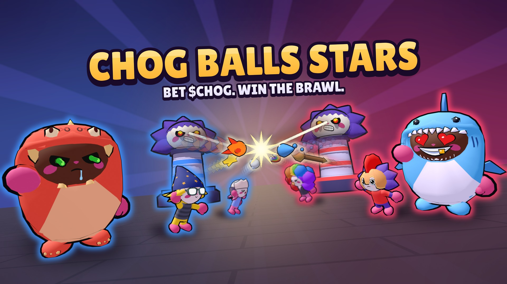

<p align="center">
  
</p>

<h1 align="center">Chog Balls Stars</h1>

<p align="center">
  <b>Bet $CHOG on a brutal 3v3 MOBA where the Chogs come alive.</b><br>
  Built for the Chogathon on Monad.
</p>

<p align="center">
  <a href="https://chogtanks.vercel.app/chog-balls-stars/"><b>Play now</b></a> ·
  <a href="https://chogtanks.vercel.app/chog-balls-stars/hero/">Find your hero</a> ·
  <a href="#for-judges">For judges</a> ·
  <a href="#how-it-works">How it works</a>
</p>

---

Stake on your team, fight with your own Chog Genesis, and get paid on a result nobody can fake. Matches last three
minutes, run in the phone's browser with nothing to install, and every result is decided by our server replaying the
match from Photon's own record of the inputs, then settled on Monad.

## Features

**Bet on your team**
- Stake $CHOG before the match; the winners share the losers' stakes, paid by the contract on the replayed result.
- A stake never depends on our servers staying up: with no result an hour after the first stake, anyone can have every
  stake given back.
- Part of every payment is burned; the players who played a Genesis in the match share a cut of the lost stakes.

**The Chogs come alive**
- All 1,969 Chog Genesis in 3D, each built from its own traits: the skulls, the Radioactives and the ten 1:1s included.
- Traits are powers. The outfit gives the class (brute, ranger, controller), the eyes the special attack, the aura its
  effect, the rarity how it is delivered, and what the Chog wears or holds its basic attack: fireballs from a Dragon
  suit, snowballs from a Russian Hat, spinning coins from a Dollar Cap.
- Two modes: **Siege**, where each team defends a tower that fires lasers from its eyes and a beating heart for a core,
  and **Coins**, a race for the coins of the arena. Bots fill the empty seats.

**Earn with your Genesis**
- Rent it out by the day for $CHOG, up to 30 days, without it ever leaving your wallet; the rent is earned by the second.
- Lend it to a friend for free with a link.
- No Genesis? Rent one by the day, play a holder's link, or start as a Recruit.

**Progress that stays with the NFT**
- Each Genesis keeps a career on Monad (matches, wins, badges, mastery) that follows it to its next holder.
- Mastery 2 unlocks a Genesis's second form, or it can be bought now with $CHOG.
- Every signed-in player climbs a ladder, Bronze to Star, on verified sieges.

## How it works

```
 Phone browser (Unity WebGL)                  Photon Quantum 3 (Public Cloud)
 ─────────────────────────────                ───────────────────────────────
  deterministic simulation  ◄──── inputs ────►  relays and records every input
  wallet (Reown / injected)                     webhooks ─┐
        │                                                 │ admission, input history
        │ sign-in, ticket, stake                          ▼
        ▼                                     Game services (Node.js on Render)
 Monad mainnet                                 ─────────────────────────────────
 ─────────────                                  checks ownership at admission
  ChogWager    ◄── signed verdict ──────────    replays each match with the judge (.NET 8,
  ChogCareers  ◄── career entries ──────────    the game's own simulation) → verdict
  ChogRental, ChogShop                          referee signs: settle, refund, careers
```

1. **Admission.** When a player joins, Photon asks our services, which read the wallet's Genesis on Monad and decide
   which hero it may play: one it holds, rents or was lent. A page cannot play any other.
2. **The match.** Photon Quantum runs the same deterministic simulation on every device and records every input on its
   server, streamed to our services as the match is played.
3. **The verdict.** When the room closes, our judge plays the whole match again from that record with the game's own
   simulation code and reads who won. A player's page is never asked who won.
4. **On chain.** The referee signs the verdict: the stake contract pays the winners or gives every stake back, and the
   careers of the Genesis that played are written to the careers contract.

## Contracts (Monad mainnet, chain 143)

| Contract | Address | What it does |
| --- | --- | --- |
| ChogWager (v3) | [`0xa9d1faa2e09753f5419d768cae05b1e2596b3e4f`](https://monadscan.com/address/0xa9d1faa2e09753f5419d768cae05b1e2596b3e4f) | Stakes per match, paid on the signed verdict; refund after an hour without one; stake by permit in one signature, relayed by the services |
| ChogRental | [`0x90c26090aea05a3dc18d6ba8fd80afe8f933bf86`](https://monadscan.com/address/0x90c26090aea05a3dc18d6ba8fd80afe8f933bf86) | Rent a Genesis by the day without moving it; rent earned by the second |
| ChogCareers | [`0x335bf7bc610645546e2b00de6a9fd0c4709d6111`](https://monadscan.com/address/0x335bf7bc610645546e2b00de6a9fd0c4709d6111) | The career of each Genesis, written by the referee after each verified match |
| ChogShop | [`0xb23a3c3492b9ba83d80c8abc9a5484d2885f058a`](https://monadscan.com/address/0xb23a3c3492b9ba83d80c8abc9a5484d2885f058a) | Buy a Genesis's second form with $CHOG |
| $CHOG | [`0x350035555e10d9afaf1566aaebfced5ba6c27777`](https://monadscan.com/address/0x350035555e10d9afaf1566aaebfced5ba6c27777) | The token staked, paid and burned |
| Chog Genesis | [`0xc96d31f8626c6d03fae5dcd3d61e3fb9f4a73763`](https://monadscan.com/address/0xc96d31f8626c6d03fae5dcd3d61e3fb9f4a73763) | The NFT collection; ownership read at sign-in and admission |

Sources and tests: [`contracts/`](contracts/README.md) (Solidity, Foundry).

## For judges

- **Play:** open [the game](https://chogtanks.vercel.app/chog-balls-stars/) on a phone held sideways or on a desktop.
  Without a wallet you play a Recruit; connect a wallet that holds a Chog Genesis to play it.
- **See the verdicts live:** [`/api/careers/recent`](https://chog-genesis-game.onrender.com/api/careers/recent) lists the
  last matches judged by the server: winner, scores, how far Photon's record went and how long judging took.
- **Read the stake setup:** [`/api/wager`](https://chog-genesis-game.onrender.com/api/wager) answers the contract, its
  version, the referee and the shares, read from the chain.
- **Replay a match yourself:** `python3 tools/quantum/fetch_live_record.py "<gameId>"` downloads Photon's record of a
  match from the services, and the judge in `site/judge/` plays it again on your machine
  (see [server/README.md](server/README.md)).

## Tech stack

Unity 6 (C#, WebGL) · Photon Quantum 3 · Blender (every hero, costume, attack object and tower modelled by Python
scripts) · Node.js services · .NET 8 judge · Solidity (Foundry) on Monad · Reown AppKit and injected wallets
(EIP-712, EIP-2612) · Render, Vercel, Upstash Redis.

## Repository

| Folder | Contents |
| --- | --- |
| [`game/`](game/README.md) | The Unity project: the simulation (Quantum), the screens, the 3D heroes as the game draws them |
| [`server/`](server/README.md) | The game services: wallet sign-in, Photon authentication and webhooks, stakes, ladder, rental, the judge's host |
| [`contracts/`](contracts/README.md) | The Solidity contracts and their Foundry tests |
| [`tools/blender/`](tools/blender/) | The scripts that build every hero from its traits, the attack objects, the structures and the banner's layers |
| [`tools/quantum/`](tools/quantum/) | The judge (`Verifier.cs`), the headless simulation tests, map tools |
| [`tools/release/`](docs/DEPLOY.md) | Assembling, checking and deploying the site and the services |
| [`web/hero/`](web/README.md) | The page where anyone looks up a Genesis as its hero card |
| [`content/`](content/README.md) | The Genesis catalogue: traits, classes, specials and their attribution |
| [`docs/`](docs/STATUS.md) | Status log, architecture, deployment, submission draft |

## Running the checks

```sh
cd server && npm test                                   # the services
cd contracts && forge test                              # the contracts
sh tools/dev/view_tests.sh                              # the game's view code, outside Unity
python3 tools/quantum/headless.py test                  # the simulation, headless
sh tools/release/check_judge.sh <path to dotnet>        # the judge agrees with recorded matches
```

Running the services locally: `node server/src/local.js` (see [server/README.md](server/README.md)). Building the
game needs Unity 6000.6 with WebGL (see [game/README.md](game/README.md)).

## Credits

Built on Photon's Quantum 3 Twin Stick Shooter sample (its map, controls, bots and menu framework, restyled), with
Cartoon FX effects from the sample. Fonts: Lilita One, Nunito, Koulen (SIL Open Font License). Sounds and music: CC0
files from Kenney and OpenGameArt, each listed in `game/Assets/Chog/Audio/LICENSES.md`. Chog Genesis art and traits
belong to their collection; everything else (the 3D heroes, the services, the judge, the contracts, the screens) was
written during the hackathon.
