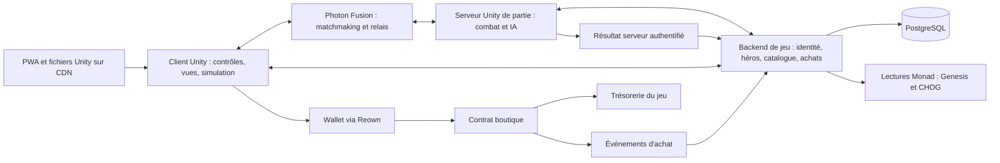

# Archive de conception — candidat Fusion Server

**Cette architecture a été remplacée le 8 octobre 2026 par
[l'architecture Quantum active](ARCHITECTURE-QUANTUM.md) après le
[réexamen du choix réseau](DECISION-RESEAU-REVUE.md).** Les sections ci-dessous conservent
les hypothèses et le travail Fusion antérieurs ; elles ne gouvernent plus le développement
du MOBA. La preuve du prototype Fusion reste dans `game-fusion/`.

8 octobre 2026. **Unity + Photon Fusion 2, serveur dédié dès le MVP.** Le SDK est choisi ;
les mesures servent à régler et dimensionner cette architecture. `game-fusion/` contient
Fusion 2.1.3 build 2390 et une arène Archer Server/Client. Huit contrôles réseau passent
dans un même processus Unity via Photon ; les services Genesis/$CHOG restent à intégrer.
`game/` conserve le sample Quantum ; ses tests sont des preuves distinctes.
Les noms de modules ci-dessous désignent nos responsabilités, pas des API Photon inventées.

## 1. Choix technique arrêté

[Décision, comparaison et tarifs vérifiés](DECISION-RESEAU.md). La priorité mobile conduit
à placer IA des bots/minions, objectifs et validation du combat sur un serveur de partie.
Le client prédit son héros et présente les états reçus des autres unités. Cette répartition
est documentée ; aucun gain de FPS sur le Redmi 11C déclaré n'est encore mesuré.
[Prédiction Fusion](https://doc.photonengine.com/fusion/v2/manual/advanced/time-synchronization).

Le serveur est un build Unity Linux sans rendu, hébergé sur une machine à nous ou un VPS.
Il ne signifie pas une machine physique par partie ni un abonnement Photon Enterprise.
Photon Public Cloud suffit pour le matchmaking et le relais ; le calcul des parties est
un coût supplémentaire. Plusieurs instances peuvent partager une machine après mesure.
[Serveur dédié Fusion](https://doc.photonengine.com/fusion/v2/concepts-and-patterns/dedicated-server-overview).

Photon recommande Shared pour WebGL et déconseille Host/Server par défaut. Nous acceptons
la configuration explicite client/serveur WebGL et son coût de transport pour disposer d'une
autorité de combat indépendante des joueurs. Le navigateur ne sera jamais serveur de partie.
Shared ne sera pas une architecture provisoire à réécrire après le MVP.
[Topologies et WebGL](https://doc.photonengine.com/fusion/v2/fusion-choose).

Unity 6000.6.4f1 arm64 et le module WebGL sont installés. Fusion 2.1.3 build 2390 et
Mono.Cecil 1.10.2 sont intégrés ; compilation C# Editor et qualification réseau réussies.
Un garde-fou de `NetworkSceneManagerDefault.Initialize` appelle `ClearStatics()` si son
registre est nul, cas observé après le démarrage Play dans notre éditeur sans rendu.
[Correctif à réexaminer au prochain SDK](../tools/unity/patches/fusion-2.1.3-scene-initialization.patch).
Cela ne constitue pas une certification générale Unity 6000.6 par Photon.
Le build WebGL Archer a réussi (~12,9 Mo). Menu, entraînement et commandes tactiles sont
vérifiés dans Chrome avec émulation et rendu logiciel ; aucun essai téléphone ni
benchmark mobile n'est acquis. [Preuve web](../research/evidence/fusion-webgl-qualification.json).
La préférence PWA et le rendu en vue haute 3D/isométrique sont conservés ; la simulation
du déplacement peut rester plane. Les cibles graphiques et de mémoire seront mesurées.

Le catalogue C# indépendant de Photon reste la source des profils Genesis. Le binder,
les assets et les systèmes Quantum seront remplacés par une intégration Fusion explicite.
Le catalogue est référencé par package local. `PointerCapture` a été transféré et les
contrôles de l'arène utilisent Input System ; le HUD et deux contacts tactiles ont été
essayés dans Chrome. L'appareil réel et le parcours réseau navigateur restent à qualifier.
Le sample et ses preuves restent conservés, sans élargir ses systèmes MOBA.
[Architecture Quantum précédente](../research/archive/architecture-quantum-before-network-decision-2026-10-08.md).

La copie CHOGTANKS sert de référence à l'intégration wallet, aux lectures RPC et aux salons.
Elle utilise PUN 2 et des contrôleurs 2D latéraux. Extraire uniquement les éléments utiles,
en retirant les couplages, mocks et paramètres testnet. Ne pas importer son projet entier.
[Audit local](../research/evidence/moba-feasibility-and-reuse.json).

## 2. Vue d'ensemble



Déploiement initial : client statique, Photon Cloud, instance(s) Unity de partie sans rendu,
backend C# ASP.NET Core et PostgreSQL. Un superviseur lance et arrête les parties, indique
leur disponibilité au matchmaking et borne leur consommation. Pas de Kubernetes requis au
prototype. API/base et parties peuvent partager une machine au début si les mesures le
permettent, avec ressources bornées ; les ticks de combat ne doivent pas bloquer l'API.

C# permet de partager les types et la résolution des héros avec Unity et le backend.
La bibliothèque partagée doit cibler un framework compatible avec l'éditeur retenu ; la version
du runtime backend est fixée après compilation. Le bénéfice est une seule règle de
conversion traits → profil, testée aux deux extrémités.

## 3. Responsabilités

| Module proposé | Possède | Ne reçoit pas comme vérité |
| --- | --- | --- |
| `HeroCatalog` | Rôles, capacités, tables de traits, expressions des tiers, fiches 1:1, compatibilités. | Statistiques libres ou mapping décidé par le joueur. |
| `HeroResolver` | Fonction de conversion déterministe, explication du build, validation des références. | « Rareté » fournie par le navigateur ou prix de marché. |
| `Simulation` | Déplacements, combat, cooldowns, états, minions, tours, noyaux, victoire et bots. | Dégâts et victoire annoncés librement par le client. |
| `Presentation` | Modèles, animations, caméra, sons, HUD, télégraphes et effets. | Animation Unity comme source d'un dégât ou cooldown. |
| `GameServices` | Identité, propriété, admission, carrière et droits d'achat. | Adresse de wallet affichée comme preuve de connexion. |
| `Commerce` | Catalogue de vente, suivi des transactions et événements confirmés. | Hash de transaction ou screenshot comme preuve suffisante de paiement. |
| `Operations` | Versions de build, logs corrélés, sauvegardes, métriques, outils de test. | Un process démarré comme preuve de parcours utilisateur réussi. |

Les vues distinguent feedback prédit et événements confirmés afin qu'un rollback ne joue
pas deux fois un son de mort ou une récompense. Les dégâts, le respawn et la victoire sont
décidés par les systèmes ; les animations suivent ces transitions. L'interface gère les
états Loading, Lobby, Admission, Match, Reconnecting et Results, avec sorties explicites.
Un échec d'achat et une perte de connexion en match ne réinitialisent pas le même parcours.

**Simulation Fusion** : le serveur possède l'état faisant autorité. Les inputs du héros
local sont prédits puis réconciliés ; les autres entités sont interpolées, sauf besoin
explicite mesuré. IA, victoire et attribution des dégâts ne s'exécutent pas comme décisions
clientes. L'état réseau utilise les types Fusion du SDK acquis (`Networked`, `TickTimer`,
`INetworkInput`). Les définitions
de capacités restent figées par manifeste ; cooldowns et effets actifs sont des états de match.
[Inputs client/serveur](https://doc.photonengine.com/fusion/v2/manual/input/player-input).

Implémenter les primitives de capacité retenues dans Fusion, en utilisant le sample Quantum
comme référence de comportement. Ajouter seulement celles
que le premier combat exige : projectile, zone, déplacement court, dégâts, effet de statut
et impulsion selon la conception retenue. Une nouvelle configuration se fait par données ;
un comportement inédit peut demander une nouvelle primitive testée. Aucun éditeur visuel
universel de sorts n'est nécessaire au prototype.

Les bots produisent les mêmes intentions que les joueurs et utilisent les mêmes règles de
combat, côté serveur. Leur stratégie est simple : accompagner une vague, attaquer une cible
valide, reculer si nécessaire, défendre le noyau. Remplacement sur déconnexion et reprise
du contrôle doivent être implémentés et testés dans Fusion.

### 3.1 Reprendre l'expérience du Twin Stick Shooter

**Direction recommandée après l'essai utilisateur du 8 octobre : porter le gameplay et
la présentation du sample Quantum dans `game-fusion/`.** L'utilisateur confirme que
l'arène Fusion fonctionne mais préfère nettement l'expérience du sample précédent.
L'essai ne précise pas le périphérique. Fusion Server reste le choix validé ; l'arène
actuelle a qualifié le réseau, sans reprendre la richesse de combat du sample.

Les sources sont disponibles : aucune décompilation n'est nécessaire. L'[inspection
reproductible](../research/evidence/quantum-to-fusion-reuse-inspection.json) relève les six
compétences, les paramètres de caméra et les dépendances Unity des trois personnages.
Le graphe de GUID comprend 83 assets, dont des scripts et une DLL Quantum : c'est un
inventaire de dépendances, **pas un paquet importable**. Les références numériques Quantum,
les chargements dynamiques et certaines références de packages ne sont pas résolus.

| Piste examinée | Apport établi | Adaptation nécessaire / choix |
| --- | --- | --- |
| [Twin Stick Shooter Quantum](https://doc.photonengine.com/quantum/v3/game-samples/twin-stick-shooter) reçu | Trois archétypes, deux compétences par personnage, bots, équipes ; expérience appréciée par l'utilisateur. Sources, prefabs et paramètres examinés localement. | Référence principale de comportement et de présentation. Réécrire simulation/IA et adaptateurs réseau pour Fusion. |
| [Tanknarok Fusion 2](https://doc.photonengine.com/fusion/v2/game-samples/tanknarok/overview) | Arène 3D jusqu'à quatre joueurs, lobby/manches/victoire, tactile, projectiles stockés dans un buffer. Documentation détaillée et extraits de code examinés. | Référence ciblée pour projectiles, pooling et flux de partie. Tanks en chacun pour soi ; versions Host/Shared. Classes, équipes et serveur sans joueur local demanderaient une adaptation. Archive non acquise, téléchargement web refusé 403 ; code complet non audité. |
| [Fusion Starter](https://doc.photonengine.com/fusion/v2/game-samples/fusion-starter/overview), [Simple FPS](https://doc.photonengine.com/fusion/v2/game-samples/simple-fps/overview), [BR200](https://doc.photonengine.com/fusion/v2/game-samples/br200/overview) | Exemples de contrôles/animations ; les deux derniers proposent des parcours serveur dédié. Documentation examinée. | Références ponctuelles. Leurs boucles plateforme/FPS/battle royale ne reprennent pas le combat du sample déjà essayé. Aucun import ni benchmark comparatif. |

Ce choix vise une expérience déjà appréciée et dont les règles sont inspectables.
Il ne repose pas sur une estimation de temps de portage ou de FPS non mesurée.

**Frontière du portage :**

- Réutiliser les modèles, clips, contrôleur Animator, matériaux et éléments de décor
  sélectionnés, avec GUID et provenance conservés. Construire des prefabs de présentation
  sans `QuantumEntityView`, prototypes générés ni DLL Quantum. Les deux projets utilisent
  actuellement le pipeline Built-in ; cela ne prouve pas à lui seul une compatibilité visuelle.
- Adapter caméra, animations, aperçu de visée, jauges, sons et effets à un état de présentation
  produit par Fusion. La simulation décide des impacts ; les animations les accompagnent.
  Dédupliquer les effets lors de la réconciliation ; le serveur sans rendu n'utilise aucun HUD.
- Porter les intentions de tir, ressources, verrous, trajectoires, formes d'impact et statuts
  sur les ticks/physique Fusion. La visée doit conserver une distance pour les attaques
  balistiques ; le déclenchement au relâchement doit survivre à plusieurs images entre deux
  ticks réseau. Les valeurs du relevé sont une référence, pas un nouvel équilibrage.
- Réimplémenter les bots côté serveur en utilisant les mêmes intentions et règles de combat.
  Les graphes du Bot SDK Quantum ne se transfèrent pas directement dans Fusion.
- Conserver les deux actions d'origine pour le premier essai comparatif. Le troisième slot
  de P1 est ensuite la signature Genesis ; le catalogue partagé fixe le profil de la partie.
  L'identité NFT et les achats ne dépendent pas du modèle de personnage temporaire.

**Première tranche livrée et qualifiée en Editor/Chrome :** Archer, visée/aperçu/relâchement,
attaque et spécial, caméra, animation, feedback d'impact, jauges et adversaire bot. Les PV
et dégâts ont été adaptés à l'arène et le bot d'entraînement attend d'être touché avant
de riposter ; ces choix sont documentés dans [la preuve](../research/evidence/fusion-archer-slice.json).
Comparer côte à
côte avec le sample, puis vérifier deux clients dont un navigateur. Ajouter ensuite le
second archétype et les deux profils Genesis de P1 avec leur signature distincte. Ce passage
ne déclare ni P0 ni P1 terminé avant leurs contrôles mobiles/réseau respectifs.

**Provenance des assets :** `game/License.txt` autorise le développement interne mais renvoie
aux auteurs pour la diffusion des assets. Les pages originales [Dungeon Pack legacy](https://kaylousberg.itch.io/kaykit-dungeon)
et [Character Animations legacy](https://kaylousberg.itch.io/kaykit-animations) indiquent CC0.
Le sample contient aussi du contenu JMO/Cartoon FX et audio : conserver leurs licences
propres pour les éléments sélectionnés ; la licence d'un pack KayKit ne couvre pas tous les
assets de la scène. Cette vérification ne bloque pas l'essai interne autorisé.

Reproduire le relevé local :

```sh
python3 tools/unity/inspect_sample_reuse.py --output research/evidence/quantum-to-fusion-reuse-inspection.json
```

## 4. Identité, données et versions

Les structures suivantes sont des contrats conceptuels. La sérialisation utilisera ensuite
les types compatibles Fusion, sans graphes de données arbitraires dans les états réseau.

| Structure | Champs essentiels | Invariant |
| --- | --- | --- |
| `GenesisIdentity` | `chainId`, `collection`, `tokenId`, `metadataId`, `metadataUri`, `metadataHash` | La clé persistante est chaîne + collection + tokenId canonique. |
| `GenesisTraits` | Paires brutes et état explicite présent/absent ; source et hash. | La casse ou l'absence d'un trait ne sont normalisées qu'avec une règle tracée. |
| `HeroDefinition` | `archetypeId`, `basicAttackId`, `classAbilityId`, `signatureFamilyId`, `tierExpressionId`, `exceptionId?` | Catalogue complet, références existantes, effets expliqués au joueur. |
| `HeroCareer` | Maîtrise, spécialisations acquises, variante équipée, version de profil. | Stocké sous NFT ; séparé des préférences et du rang du joueur. |
| `MatchManifest` | `matchId`, map, mode, roster, slots/bots, rulesetVersion, contentHash, serverBuildId, session config. | Serveur et clients acceptent la même version de règles et de contenu. |
| `Admission` | Joueur authentifié, NFT, slot, héros résolu, expiration, match lié. | Pas de choix de statistiques arbitraires par le client. |
| `MatchResult` | Match, fin de simulation, vainqueur, événements utiles, état de vérification. | Une récompense au plus par couple match / NFT. |
| `Purchase` | Chaîne, contrat boutique, txHash, logIndex, tokenId, sku, version de catalogue, état. | L'événement canonique crédite exactement un droit. |

Conserver des identifiants stables pour les classes, capacités et SKU. Une version de règles
n'écrase pas les données nécessaires pour interpréter les anciennes parties. Les builds,
manifestes et données utiles à l'audit des résultats sont archivés par version.

Contenu versionné proposé : `heroes`, `abilities`, `trait-rules`, `tier-expressions`,
`unique-genesis`, `maps`, `economy`. Employer les assets natifs du sample lorsqu'ils sont
appropriés ; exporter un manifeste JSON pour le backend et l'inspection. Une seule source
est éditable pour chaque règle, les exports sont générés. Ne pas entretenir deux tables de
combat séparées en C# et TypeScript.

## 5. Connexion et admission dans une partie

1. Challenge de connexion court, nonce à usage unique, domaine et chaîne attendus ; signature
   validée côté backend. Une connexion Reown seule ne suffit pas à authentifier notre API.
2. Lecture de possession sur Monad, récupération des metadata depuis notre cache indexé,
   résolution du héros et récupération de ses spécialisations.
3. Création/rejoindre un salon à code ou file simple ; admission liée au joueur, NFT et match.
   Un NFT a un seul bail de jeu actif. Expiration et reprise du même match sont distinguées.
4. Authentification Photon liée à cette session ; le serveur de partie vérifie l'admission
   liée à son instance et charge le profil approuvé par le backend. Les statistiques proposées
   par le client ne font pas autorité. Le token d'admission expire et ne sert que pour ce match.
5. Partie avec inputs réseau uniquement ; les metadata, RPC et opérations wallet restent
   hors de la boucle de combat. Si le backend devient indisponible, la partie déjà admise
   peut continuer et son résultat attend la reprise des services.

Pour un transfert de NFT pendant un match : le profil du match reste figé jusqu'à sa fin.
L'ancien propriétaire ne peut plus rejoindre une nouvelle partie ; le nouveau voit si le
héros est encore engagé, avec une durée de bail bornée. La carrière est créditée au NFT de
la partie. Le backend revérifie `ownerOf` à chaque nouvelle admission ; l'invalidation par
événement Transfer accélère les écrans mais ne remplace pas cette lecture.

MVP : entraînement sans wallet avec héros de démonstration signalés ; jeu public avec Genesis
possédé. Un prêt nécessite plus tard un droit explicite et révocable. Pas de simulation de
propriété présentée comme une possession réelle dans une démo de jury.

[SIWE/ERC-4361](https://eips.ethereum.org/EIPS/eip-4361) sert de référence pour le challenge.
Définir le traitement des wallets contrats avant de les annoncer supportés ; vérifier les
signatures compatibles avec la méthode d'authentification choisie.

## 6. Résultats et progression

Notre serveur Unity de partie, et non un joueur ni le relais Photon, valide le combat.
Sa déclaration authentifiée est la source du résultat. Le backend ne reçoit pas un gagnant
libre déclaré par le navigateur. Le serveur reste responsable de valider les inputs et les
capacités ; la topologie ne protège pas automatiquement d'une erreur de règles.

Chemin prévu :

1. Le serveur fixe la fin du match et réplique le résultat aux clients.
2. Il transmet le résultat au backend via une identité de service liée à l'instance et au
   manifeste enregistrés, avec match, participants, version et événements de carrière.
3. Le backend vérifie instance/admissions/version et déduplique la soumission ; les secrets
   serveur ne sont jamais inclus dans le client web. Les reprises ne peuvent pas remplacer
   un résultat déjà accepté par un résultat différent.
4. Une transaction de base de données marque le résultat accepté et applique la progression
   une fois. Une reprise du worker ne peut pas doubler les récompenses.

Un résultat incomplet, non authentifié ou incompatible reste `Pending` ou `Rejected`,
jamais « vérifié par majorité des clients ». Prévoir reprise persistante de l'envoi côté
serveur. Une panne de backend retarde la progression sans bloquer le retour au lobby.
Les replays visuels et outils de diagnostic sont des extensions distinctes : aucun replay
déterministe Fusion hors Unity n'est supposé disponible.

## 7. Achat $CHOG

Contrat de boutique minimal proposé, dédié à la collection Genesis et au token $CHOG connus :
prix et SKU versionnés, contrôle de propriété, transfert vers trésorerie et événement d'achat
dans une même transaction. Le client transmet la version/prix maximal attendu ; un changement
de prix ne doit pas provoquer un débit inattendu. Un droit déjà acheté ne peut pas être
facturé de nouveau pour le même NFT et la même spécialisation.

Utiliser un transfert ERC20 sûr après vérification des comportements réels du token :
le succès d'un appel n'établit pas à lui seul le montant effectivement reçu pour tous les
ERC20. Aucun support de token avec frais n'est supposé. Le MVP peut refuser un transfert
dont le montant reçu diffère du prix attendu. L'autorisation, si requise, est limitée au
montant utile et présentée avant signature. Pas de garde des fonds des joueurs par notre API.

L'indexeur lit les événements depuis un curseur persistant, vérifie contrat, chaîne,
transaction réussie et règle de confirmation retenue. Il suit les blocs et leur hash pour
reconnaître une éventuelle réorganisation. Après confirmation, il applique l'achat avec une
clé unique `(chainId, shopAddress, txHash, logIndex)`. L'état de confirmation est consultable
après fermeture de l'onglet.

Les prix sont des entiers en unités minimales (CHOG : 18 décimales selon les lectures), jamais
des flottants monétaires. Aucune API ne demande une clé privée. Paramètres par environnement :
chainId, RPC, Genesis, CHOG, shopAddress, treasury. Contrats mainnet documentés dans
[les preuves](../research/evidence/chog-erc20-facts.json).

Avant usage réel : tester propriété incorrecte, allowance insuffisante, refus wallet,
revert, transfert simultané du NFT, achat déjà effectué, changement de prix, événements en
double et indisponibilité du backend. Le déploiement/mainnet nécessite les paramètres et
l'autorisation de transaction appropriés ; ce plan n'en exécute aucune.
[Référence SafeERC20](https://docs.openzeppelin.com/contracts/5.x/api/token/erc20).

## 8. PWA, visuels et performance

Unity WebGL embarqué dans une enveloppe légère : page de chargement, manifest, icônes et
service worker. L'installation est facultative pour jouer. HTTPS, types MIME et compression
des builds configurés sur l'hébergement. Une session multijoueur exige le réseau ; une page
hors ligne indique l'état et propose de reprendre la connexion.

Les fichiers de build sont nommés/versionnés immuablement. Le service worker ne mélange pas
deux versions, ne cache pas les réponses personnelles d'authentification/achat et n'active
pas une nouvelle version en pleine partie. API et Photon refusent les combinaisons de
manifest incompatibles. Le retour à une version stable restaure un ensemble cohérent.

Reown Unity documente Gamma et un stripping minimal. Les vérifier dans le premier build,
avant le choix de shaders définitifs. Si une contrainte s'avère incompatible, un AppKit dans
l'enveloppe web avec bridge Unity devient une option étudiée, avec son coût propre ; pas un
second chemin wallet développé simultanément.
[Installation Reown](https://docs.reown.com/appkit/unity/core/installation).

Prototype : capsules, cubes, couleurs d'équipe, volumes d'attaque visibles et quelques sons
fonctionnels. Les collider, points d'émission et hitboxes sont définis indépendamment du mesh.
Un modèle final s'insère dans un `VisualRoot` avec conventions de points d'attache, animation
et échelle ; il n'impose pas une réécriture des capacités.

Budget visuel initial : caméra fixe, lumière simple, effets courts, peu de transparences
superposées, pooling des projectiles/effets, nombre d'entités suivi. Le nombre de minions et
la fréquence de leur décision sont bornés par les mesures. Ajouter Addressables/chargement
différé si le poids ou le démarrage le justifient. Rester en configuration web simple avant
d'introduire des contraintes expérimentales de multithreading.

Le navigateur utilise WebSocket/TCP ; les interruptions d'app et l'arrière-plan mobile doivent
être traités par la reconnexion et les bots côté serveur. Une PWA n'améliore pas automatiquement
cette contrainte de réseau. [Limites Photon WebGL](https://doc.photonengine.com/fusion/v2/fusion-choose#webgl_builds).

## 9. Organisation du dépôt prévue

`shared/`, `content/`, `tools/` et les fixtures sous `tests/` existent désormais pour le
catalogue C#. Les autres dossiers seront créés avec leur première fonctionnalité.

```text
game/                 précédent sample Quantum, conservé avec ses preuves
game-fusion/          projet Fusion existant, arène Server/Client ; services Genesis à brancher
shared/               identité, résolution et contrats partagés compatibles Unity/.NET
backend/              API, webhooks, carrière, indexeur d'achats
game-server/          orchestration/configuration des instances Unity, pas un second moteur de combat
contracts/            boutique et tests de paiement
web/                  enveloppe PWA et configuration de build
content/              source de contenu si non portée par les assets natifs Unity
ops/                  configuration d'hébergement, sauvegarde et reprise
docs/                 plan, architecture, état courant
research/evidence/    sources publiques, données et limites d'observation
tools/                outils locaux de compilation et de vérification
tests/fixtures/       metadata réelles et bindings on-chain utilisés pour les tests
```

Ne pas créer une hiérarchie vide ou une abstraction pour chaque case : matérialiser ces
frontières avec la première fonctionnalité qui les utilise. Préserver les `.meta` Unity,
verrouiller les packages et consigner l'origine des fichiers tiers ; vérifier leurs droits
de redistribution avant de publier un dépôt contenant un sample.

## 10. Contrôles qui empêchent la dette la plus coûteuse

| Risque | Contrôle utile | Moment |
| --- | --- | --- |
| Héros invalide ou trait oublié | Validation de l'inventaire entier, des références et de quelques profils attendus indépendamment des règles. | Chaque modification de catalogue. |
| Désaccord client/serveur | Scénarios déplacement, capacités, mort/respawn/objectif, réconciliation et reconnexion ; résultat décidé uniquement par le serveur. | Premier match et changements de simulation. |
| Faux NFT ou fausse compétence | Tests d'admission avec adresse, profil, version, slot et droit invalides. | Avant matchmaking public. |
| Achat ou XP doublé | Rejeu de webhooks, concurrence et redémarrage entre lecture/écriture ; contraintes uniques en base. | Avant persistance et commerce. |
| Changement visuel qui casse le combat | Substitution d'un mesh placeholder sans modification des résultats d'une séquence de simulation. | Première intégration d'assets finaux. |
| Mise à jour PWA incohérente | Client ancien, nouveau build, cache existant, retour arrière et partie déjà lancée. | Avant chaque publication candidate. |
| Démo indisponible | Healthcheck, logs corrélés au match/achat, sauvegarde testée et guide de reprise. | Avant soumission. |

Les tests visent les invariants et les pannes plausibles. Les changements de texte ou les
réglages visuels réversibles n'exigent pas une nouvelle batterie de tests automatisés.

## 11. Exploitation et coûts à renseigner

Les [tarifs et conditions vérifiés](DECISION-RESEAU.md) distinguent Photon des machines de
parties, de l'API/base, du CDN, des RPC et du stockage. Gratuit Photon : 100 CCU plafonnés,
une application Fusion ou Quantum par client. Premier palier avec burst : 500 CCU à
125 $/mois. Aucun abonnement ou hébergement n'a été activé par ce choix d'architecture.
Les bots n'ouvrent pas une connexion chacun mais consomment des ressources du serveur.

Avant ouverture : noter fournisseur/région, parties par machine mesurées, p95 du tick serveur,
coûts fixes, poids du build, trafic par match, limites RPC et expiration des logs. Exposer un état de service
et une configuration pour désactiver une vente défaillante sans arrêter les matchs existants.
Clés serveur et identités de service en variables d'environnement ; identifiants publics de
client séparés. Sauvegarde et reprise vérifiées pour la carrière et les achats.

La décision réseau est prise. P0 doit livrer un premier client web et son serveur Fusion ;
les mesures déterminent les budgets exécutables et la capacité, sans différer le choix du SDK.
