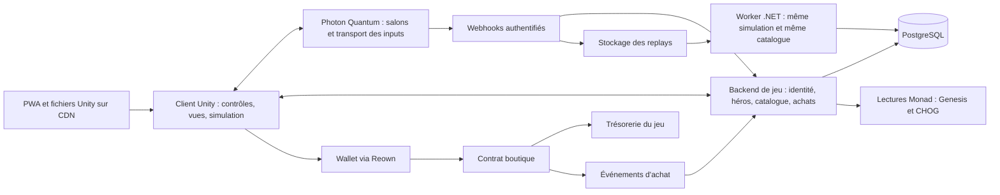

# Architecture proposée — MOBA Genesis

8 octobre 2026. À lire avec [PLAN.md](PLAN.md). **Architecture cible ; résolution et liaison
des héros testées avec le SDK Quantum officiel (.NET, 41 tests). Premier import Unity
effectué et sample local fonctionnel confirmé par l'utilisateur ; aucun build WebGL ni
match réseau vérifié. Contrôles tactiles adaptés ; neuf tests Unity passés.**
Les noms ci-dessous désignent nos modules et contrats de données proposés, pas des API
Photon inventées. Source acquise : Quantum 3.0.9, Unity 2021.3.45f2 ; version cible Unity 6
à qualifier avant de la figer.

## 1. Choix technique et décision encore nécessaire

Choix de travail : **Unity + Quantum 3 Twin Stick Shooter**, rendu 3D et simulation plane.
Une caméra fixe en perspective haute/isométrique ne requiert pas une simulation de mouvement
3D avec sauts et gravité. On conserve le contrôleur du sample s'il satisfait les tests.

Pourquoi ce candidat : son périmètre documenté comporte top-down, capacités paramétrables et
bots ; l'ajout de signatures de NFT réutilise ces besoins. Les replays permettent aussi de
reprendre la même simulation pour vérifier la carrière persistante. Le coût à mesurer est
l'apprentissage des conventions déterministes et l'adaptation du mode Coin Grab au MOBA.

Le ZIP fourni par l'utilisateur est extrait dans `game/`. Ses 6 656 fichiers ont été
comparés par SHA256 à l'extraction. Depuis, l'intégration Genesis et la migration ont
modifié le sample. L'utilisateur a installé et ouvert Unity **6000.6.4f1 arm64**, avec WebGL.
Les corrections API du SDK compilent dans cet éditeur ; l'utilisateur confirme un redémarrage
sans erreur et le journal montre le mode Default. Les packages IAP et Advertisement
Legacy inutilisés ont été retirés ; Ads déclenchait une demande d'import MDR sans rapport
avec le gameplay. Aucun build WebGL validé.
[Procédure de qualification et points d'intégration](../game/README.md).

**Migration cible recommandée : Unity 6**, qui documente le support des navigateurs mobiles.
La version de développement actuellement installée est 6000.6.4f1 ; la version finale ne
sera figée qu'après build et essai sur téléphone. Les adaptations du SDK gardent des
conditions de version et seront réexaminées lors d'une mise à jour Photon.
Le sample 2021.3.45f2 reste la référence d'origine ; Reown demande au moins 2022.3.
Ne pas installer un ancien éditeur uniquement pour reproduire cette version si Unity 6
peut être remis en service. Mesurer la migration avant les extensions de gameplay.
[Unity Web](https://docs.unity3d.com/6000.0/Documentation/Manual/webgl-browsercompatibility.html),
[prérequis Reown](https://docs.reown.com/appkit/unity/core/installation).

La lecture du code confirme un coût oublié par la description générale du sample : deux
actions seulement (`BasicSkillData`, `SpecialSkillData`) et UI tactile initialement désactivée
en WebGL. La sélection runtime des contrôles et la capture des pointeurs sont maintenant
implémentées ; neuf tests EditMode ont passé dans Unity. Un vrai essai navigateur/mobile
reste nécessaire. `Chog.Controls` ne possède aucune règle de simulation.
Ajouter notre troisième slot demande DSL/input/simulation/HUD/bots. Les systèmes sont configurés
dans `TSS-SystemsConfig.asset`. Conserver ces contraintes dans P0/P1 et les vérifier avant
de produire un roster. Le modèle de replay fourni cible .NET 8, simulation .NET Standard 2.1.

**Critère d'arrêt de la qualification** : compiler le sample, faire jouer deux clients dont
un téléphone, modifier une capacité par les données du sample, enregistrer/rejouer une session
et mesurer les coûts. En cas d'obstacle identifié, comparer le travail restant à Fusion 2
avant de développer les systèmes MOBA. Aucun adaptateur générique censé remplacer Quantum
par Fusion à chaud n'est prévu : cette migration changerait réellement la simulation.

La copie CHOGTANKS sert de référence à l'intégration wallet, aux lectures RPC et aux salons.
Elle utilise PUN 2 et des contrôleurs 2D latéraux. Extraire uniquement les éléments utiles,
en retirant les couplages, mocks et paramètres testnet. Ne pas importer son projet entier.
[Audit local](../research/evidence/moba-feasibility-and-reuse.json).

## 2. Vue d'ensemble



Déploiement initial recommandé : un client statique, Photon Cloud, un backend C# ASP.NET Core,
PostgreSQL et un worker de replay issu du même dépôt. Le worker peut partager le déploiement
du backend avec une limite de concurrence ; les grosses sessions ne doivent pas bloquer
l'authentification. Stockage persistant des replays sur volume en développement puis objet
compatible S3 en hébergement. Pas de microservices par fonctionnalité.

C# permet de partager les types et la résolution des héros avec Unity et le runner de simulation.
La bibliothèque partagée doit cibler un framework compatible avec l'éditeur retenu ; la version
du runtime serveur est fixée après compilation du SDK. Le bénéfice est une seule règle de
conversion traits → profil, testée aux deux extrémités.

## 3. Responsabilités

| Module proposé | Possède | Ne reçoit pas comme vérité |
| --- | --- | --- |
| `HeroCatalog` | Rôles, capacités, tables de traits, expressions des tiers, fiches 1:1, compatibilités. | Statistiques libres ou mapping décidé par le joueur. |
| `HeroResolver` | Fonction de conversion déterministe, explication du build, validation des références. | « Rareté » fournie par le navigateur ou prix de marché. |
| `Simulation` | Déplacements, combat, cooldowns, états, minions, tours, noyaux, victoire et bots. | Dégâts et victoire annoncés librement par le client. |
| `Presentation` | Modèles, animations, caméra, sons, HUD, télégraphes et effets. | Animation Unity comme source d'un dégât ou cooldown. |
| `GameServices` | Identité, propriété, admission, carrière et droits d'achat. | Adresse de wallet affichée comme preuve de connexion. |
| `Commerce` | Catalogue de vente, suivi des transactions et événements confirmés. | Hash de transaction ou screenshot comme preuve suffisante de paiement. |
| `Operations` | Versions de build, logs corrélés, sauvegardes, métriques, outils de test. | Un process démarré comme preuve de parcours utilisateur réussi. |

Les vues distinguent feedback prédit et événements confirmés afin qu'un rollback ne joue
pas deux fois un son de mort ou une récompense. Les dégâts, le respawn et la victoire sont
décidés par les systèmes ; les animations suivent ces transitions. L'interface gère les
états Loading, Lobby, Admission, Match, Reconnecting et Results, avec sorties explicites.
Un échec d'achat et une perte de connexion en match ne réinitialisent pas le même parcours.

**Simulation Quantum** : état mutable dans le Frame/DSL, calculs déterministes, systèmes sans
état mutable externe. Les définitions de capacités sont immuables pendant un match ; les
cooldowns et effets actifs appartiennent à l'état de simulation. Unity présente cet état.
[Contraintes officielles](https://doc.photonengine.com/quantum/v3/manual/quantum-ecs/systems).

Conserver les primitives de capacité déjà fournies par le sample. Ajouter seulement celles
que le premier combat exige : projectile, zone, déplacement court, dégâts, effet de statut
et impulsion selon la conception retenue. Une nouvelle configuration se fait par données ;
un comportement inédit peut demander une nouvelle primitive testée. Aucun éditeur visuel
universel de sorts n'est nécessaire au prototype.

Les bots produisent les mêmes intentions que les joueurs et utilisent les mêmes règles de
combat. Leur stratégie est simple : accompagner une vague, attaquer une cible valide, reculer
si nécessaire, défendre le noyau. La mécanique de remplacement du sample doit être adaptée
au mode MOBA et testée ; sa présence annoncée ne garantit pas une bonne IA de voie.

## 4. Identité, données et versions

Les structures suivantes sont des contrats conceptuels. La sérialisation utilisera ensuite
les types compatibles Quantum, sans dictionnaires arbitraires dans ses messages.

| Structure | Champs essentiels | Invariant |
| --- | --- | --- |
| `GenesisIdentity` | `chainId`, `collection`, `tokenId`, `metadataId`, `metadataUri`, `metadataHash` | La clé persistante est chaîne + collection + tokenId canonique. |
| `GenesisTraits` | Paires brutes et état explicite présent/absent ; source et hash. | La casse ou l'absence d'un trait ne sont normalisées qu'avec une règle tracée. |
| `HeroDefinition` | `archetypeId`, `basicAttackId`, `classAbilityId`, `signatureFamilyId`, `tierExpressionId`, `exceptionId?` | Catalogue complet, références existantes, effets expliqués au joueur. |
| `HeroCareer` | Maîtrise, spécialisations acquises, variante équipée, version de profil. | Stocké sous NFT ; séparé des préférences et du rang du joueur. |
| `MatchManifest` | `matchId`, map, mode, roster, slots/bots, rulesetVersion, assetDBHash, simulationBuildId, session config. | Les six participants reçoivent les mêmes règles et contenus. |
| `Admission` | Joueur authentifié, NFT, slot, héros résolu, expiration, match lié. | Pas de choix de statistiques arbitraires par le client. |
| `MatchResult` | Match, fin de simulation, vainqueur, événements utiles, état de vérification. | Une récompense au plus par couple match / NFT. |
| `Purchase` | Chaîne, contrat boutique, txHash, logIndex, tokenId, sku, version de catalogue, état. | L'événement canonique crédite exactement un droit. |

Conserver des identifiants stables pour les classes, capacités et SKU. Une version de règles
n'écrase pas les données nécessaires pour rejouer les anciennes parties. Les builds, l'asset
database et les tables de calcul requis par le runner sont archivés par version.

Contenu versionné proposé : `heroes`, `abilities`, `trait-rules`, `tier-expressions`,
`unique-genesis`, `maps`, `economy`. Employer les assets natifs du sample lorsqu'ils sont
appropriés ; exporter un manifeste JSON pour le serveur et l'inspection. Une seule source
est éditable pour chaque règle, les exports sont générés. Ne pas entretenir deux tables de
combat séparées en C# et TypeScript.

## 5. Connexion et admission dans une partie

1. Challenge de connexion court, nonce à usage unique, domaine et chaîne attendus ; signature
   validée côté backend. Une connexion Reown seule ne suffit pas à authentifier notre API.
2. Lecture de possession sur Monad, récupération des metadata depuis notre cache indexé,
   résolution du héros et récupération de ses spécialisations.
3. Création/rejoindre un salon à code ou file simple ; admission liée au joueur, NFT et match.
   Un NFT a un seul bail de jeu actif. Expiration et reprise du même match sont distinguées.
4. Authentification Photon liée à cette session ; contrôle des configurations et du profil
   par les webhooks. Le backend renvoie le profil approuvé au lieu d'accepter des stats client.
5. Partie avec inputs réseau uniquement ; les metadata, RPC et opérations wallet restent
   hors de la boucle de combat. Si le backend devient indisponible, la partie déjà admise
   peut continuer et son résultat attend la reprise des services.

Pour un transfert de NFT pendant un match : le profil du match reste figé jusqu'à sa fin.
L'ancien propriétaire ne peut plus rejoindre une nouvelle partie ; le nouveau voit si le
héros est encore engagé, avec une durée de bail bornée. La carrière est créditée au NFT de
la partie. Le backend revérifie `ownerOf` à chaque nouvelle admission ; l'invalidation par
événement Transfer accélère les écrans mais ne remplace pas cette lecture.

MVP : entraînement sans wallet avec héros de démonstration signalés ; jeu public avec Genesis
possédé. Un prêt nécessite plus tard un droit explicite et révocable. Pas de simulation de
propriété présentée comme une possession réelle dans une démo de jury.

[SIWE/ERC-4361](https://eips.ethereum.org/EIPS/eip-4361) sert de référence pour le challenge.
Définir le traitement des wallets contrats avant de les annoncer supportés ; vérifier les
signatures compatibles avec la méthode d'authentification choisie.

## 6. Résultats et progression

Photon Public Cloud transmet et ordonne les inputs ; dans cette configuration, il ne simule
pas automatiquement notre combat sur un serveur autoritaire. Le déterminisme rend les
clients cohérents, mais ne transforme pas leur déclaration de victoire en preuve serveur.
[Limites officielles](https://doc.photonengine.com/quantum/v3/manual/cheat-protection).

Chemin prévu :

1. L'écran affiche le résultat de la simulation locale comme résultat de partie.
2. Des webhooks authentifiés enregistrent la configuration approuvée et les fragments de
   replay provenant de Photon. Dédupliquer les chunks, détecter les trous et conserver
   l'identité du match et la version exacte.
3. Le worker rejoue ce flux avec les mêmes bibliothèques, asset database et tables de calcul.
   Il vérifie la fin de partie et produit les événements de carrière depuis la simulation.
4. Une transaction de base de données marque le résultat vérifié et applique la progression
   une fois. Une reprise du worker ne peut pas doubler les récompenses.

Un replay incomplet, une version manquante ou un résultat divergent reste `Pending` ou
`Rejected`, jamais « vérifié par majorité des clients ». Une panne de worker retarde la
progression, elle ne bloque pas l'affichage de la victoire ni le retour au lobby.

La documentation décrit le streaming de replay et un runner .NET. Leur disponibilité dans
notre configuration, le coût CPU par match, l'authentification des appels et le délai de
validation sont à vérifier en P0/P3. La resimulation ne détecte pas automatiquement les bots,
la collusion ou l'exploitation d'informations déjà présentes dans les clients. Un mode
compétitif plus strict ou un futur brouillard de guerre demandera une analyse supplémentaire.

Références : [webhooks](https://doc.photonengine.com/quantum/v3/manual/webhooks) et
[runner de replay](https://doc.photonengine.com/quantum/v3/manual/replay).

## 7. Achat $CHOG

Contrat de boutique minimal proposé, dédié à la collection Genesis et au token $CHOG connus :
prix et SKU versionnés, contrôle de propriété, transfert vers trésorerie et événement d'achat
dans une même transaction. Le client transmet la version/prix maximal attendu ; un changement
de prix ne doit pas provoquer un débit inattendu. Un droit déjà acheté ne peut pas être
facturé de nouveau pour le même NFT et la même spécialisation.

Utiliser un transfert ERC20 sûr après vérification des comportements réels du token :
le succès d'un appel n'établit pas à lui seul le montant effectivement reçu pour tous les
ERC20. Aucun support de token avec frais n'est supposé. Le MVP peut refuser un transfert
dont le montant reçu diffère du prix attendu. L'autorisation, si requise, est limitée au
montant utile et présentée avant signature. Pas de garde des fonds des joueurs par notre API.

L'indexeur lit les événements depuis un curseur persistant, vérifie contrat, chaîne,
transaction réussie et règle de confirmation retenue. Il suit les blocs et leur hash pour
reconnaître une éventuelle réorganisation. Après confirmation, il applique l'achat avec une
clé unique `(chainId, shopAddress, txHash, logIndex)`. L'état de confirmation est consultable
après fermeture de l'onglet.

Les prix sont des entiers en unités minimales (CHOG : 18 décimales selon les lectures), jamais
des flottants monétaires. Aucune API ne demande une clé privée. Paramètres par environnement :
chainId, RPC, Genesis, CHOG, shopAddress, treasury. Contrats mainnet documentés dans
[les preuves](../research/evidence/chog-erc20-facts.json).

Avant usage réel : tester propriété incorrecte, allowance insuffisante, refus wallet,
revert, transfert simultané du NFT, achat déjà effectué, changement de prix, événements en
double et indisponibilité du backend. Le déploiement/mainnet nécessite les paramètres et
l'autorisation de transaction appropriés ; ce plan n'en exécute aucune.
[Référence SafeERC20](https://docs.openzeppelin.com/contracts/5.x/api/token/erc20).

## 8. PWA, visuels et performance

Unity WebGL embarqué dans une enveloppe légère : page de chargement, manifest, icônes et
service worker. L'installation est facultative pour jouer. HTTPS, types MIME et compression
des builds configurés sur l'hébergement. Une session multijoueur exige le réseau ; une page
hors ligne indique l'état et propose de reprendre la connexion.

Les fichiers de build sont nommés/versionnés immuablement. Le service worker ne mélange pas
deux versions, ne cache pas les réponses personnelles d'authentification/achat et n'active
pas une nouvelle version en pleine partie. API et Photon refusent les combinaisons de
manifest incompatibles. Le retour à une version stable restaure un ensemble cohérent.

Reown Unity documente Gamma et un stripping minimal. Les vérifier dans le premier build,
avant le choix de shaders définitifs. Si une contrainte s'avère incompatible, un AppKit dans
l'enveloppe web avec bridge Unity devient une option étudiée, avec son coût propre ; pas un
second chemin wallet développé simultanément.
[Installation Reown](https://docs.reown.com/appkit/unity/core/installation).

Prototype : capsules, cubes, couleurs d'équipe, volumes d'attaque visibles et quelques sons
fonctionnels. Les collider, points d'émission et hitboxes sont définis indépendamment du mesh.
Un modèle final s'insère dans un `VisualRoot` avec conventions de points d'attache, animation
et échelle ; il n'impose pas une réécriture des capacités.

Budget visuel initial : caméra fixe, lumière simple, effets courts, peu de transparences
superposées, pooling des projectiles/effets, nombre d'entités suivi. Le nombre de minions et
la fréquence de leur décision sont bornés par les mesures. Ajouter Addressables/chargement
différé si le poids ou le démarrage le justifient. Rester en configuration web simple avant
d'introduire des contraintes expérimentales de multithreading.

Le navigateur utilise WebSocket/TCP ; les interruptions d'app et l'arrière-plan mobile doivent
être traités par la reconnexion et les bots. Une PWA n'améliore pas automatiquement cette
contrainte de réseau. [WebGL Photon](https://doc.photonengine.com/quantum/v3/manual/webgl).

## 9. Organisation du dépôt prévue

`shared/`, `content/`, `tools/` et les fixtures sous `tests/` existent désormais pour le
catalogue C#. Les autres dossiers seront créés avec leur première fonctionnalité.

```text
game/                 projet Unity, sample conservé identifiable, code de jeu séparé
shared/               identité, résolution et contrats partagés compatibles Unity/.NET
backend/              API, webhooks, carrière, indexeur d'achats
replay-worker/        exécution .NET de la simulation exportée
contracts/            boutique et tests de paiement
web/                  enveloppe PWA et configuration de build
content/              source de contenu si non portée par les assets natifs Unity
ops/                  configuration d'hébergement, sauvegarde et reprise
docs/                 plan, architecture, état courant
research/evidence/    sources publiques, données et limites d'observation
tools/                outils locaux de compilation et de vérification
tests/fixtures/       metadata réelles et bindings on-chain utilisés pour les tests
```

Ne pas créer une hiérarchie vide ou une abstraction pour chaque case : matérialiser ces
frontières avec la première fonctionnalité qui les utilise. Préserver les `.meta` Unity,
verrouiller les packages et consigner l'origine des fichiers tiers ; vérifier leurs droits
de redistribution avant de publier un dépôt contenant un sample.

## 10. Contrôles qui empêchent la dette la plus coûteuse

| Risque | Contrôle utile | Moment |
| --- | --- | --- |
| Héros invalide ou trait oublié | Validation de l'inventaire entier, des références et de quelques profils attendus indépendamment des règles. | Chaque modification de catalogue. |
| Divergence de simulation | Scénarios combat/respawn/objectif et replay identique entre clients ; compatibilité des checksums interplateformes configurée. | Premier match et changements de simulation. |
| Faux NFT ou fausse compétence | Tests d'admission avec adresse, profil, version, slot et droit invalides. | Avant matchmaking public. |
| Achat ou XP doublé | Rejeu de webhooks, concurrence et redémarrage entre lecture/écriture ; contraintes uniques en base. | Avant persistance et commerce. |
| Changement visuel qui casse le combat | Substitution d'un mesh placeholder sans modification des résultats d'une séquence de simulation. | Première intégration d'assets finaux. |
| Mise à jour PWA incohérente | Client ancien, nouveau build, cache existant, retour arrière et partie déjà lancée. | Avant chaque publication candidate. |
| Démo indisponible | Healthcheck, logs corrélés au match/achat, sauvegarde testée et guide de reprise. | Avant soumission. |

Les tests visent les invariants et les pannes plausibles. Les changements de texte ou les
réglages visuels réversibles n'exigent pas une nouvelle batterie de tests automatisés.

## 11. Exploitation et coûts à renseigner

Photon : distinguer le plafond de connexions simultanées, le trafic inclus et l'accès aux
samples. La tarification précédemment consultée mentionne notamment 100 CCU gratuits de
lancement sous conditions ; rien n'a été activé. Le runner de vérification, la base de données,
le stockage et l'API restent nos services à héberger. Les bots simulés ne représentent pas
des connexions humaines, mais consomment du CPU de simulation sur les appareils.

Avant ouverture : noter fournisseur/région, coûts fixes, coût et durée d'un replay, poids du
build, trafic par match, limites RPC et expiration des logs/replays. Exposer un état de service
et une configuration pour désactiver une vente défaillante sans arrêter les matchs existants.
Clés serveur et secrets de webhooks en variables d'environnement ; identifiants publics de
client séparés. Sauvegarde et reprise vérifiées pour la carrière et les achats.

La prochaine décision technique est P0. Le plan rend les choix et leurs limites visibles ;
le build et les mesures détermineront les versions et paramètres exécutables.
